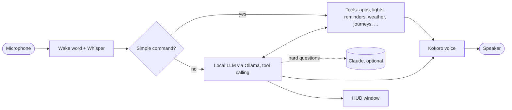

<div align="center">

# J.A.R.V.I.S.
### Local Voice Assistant for macOS

Say "Jarvis". A language model running on your own Mac decides what to do, uses tools to do it, and answers out loud.


-2EA44F?style=flat)


</div>

I built this to learn how a tool-using language model agent fits together with speech in and speech out, and to measure whether it actually works. Most of it runs offline: speech recognition, the language model, the voice and the screen-reading model all run on the Mac.

## Highlights

| | |
|---|---|
| **Listens** | A small model on the CPU spots the wake word "Jarvis"; Whisper large-v3 turbo (MLX) transcribes the command. You can say it in one breath: "Jarvis, lights off". |
| **Thinks** | A local model served by Ollama (default `gpt-oss:20b`) chooses from about 30 tools. Hard questions can go to Claude if you set an API key. |
| **Fast lane** | Simple commands (lights, volume, music, scenes, the time) are matched with rules and run instantly, without calling the model. |
| **Acts** | Opens and quits apps, controls music and volume, reads the calendar, searches the web, checks weather and journey times, controls smart lights, runs scenes and reminders. |
| **Speaks** | Replies stream sentence by sentence through a local voice (Kokoro). Speak over it to stop it; this works best with headphones. |
| **Remembers** | Facts you tell it, to-dos, daily habits and a diary, stored as plain JSON on your machine. |
| **Sees** | Ask "what am I looking at?" and a local vision model describes a screenshot, which is deleted straight after. |
| **Shows** | A small HUD window shows what it is hearing, doing and saying. |

## How it works



| Part | File | Job |
|---|---|---|
| Entry point | `main.py` | Voice plus HUD, or `--text` to type in the terminal |
| Fast lane | `jarvis/fastlane.py` | Instant answers for simple commands, no model call |
| Brain | `jarvis/brain.py` | Persona, local model with tool calling, optional Claude escalation |
| Tools | `jarvis/tools.py` | Every action it can take, each exposed to the model as a tool |
| Voice | `jarvis/voice.py` | Wake word, speech to text, text to speech, interruptions |
| Household | `jarvis/household.py`, `jarvis/memory.py` | To-dos, habits, reminders, memory |
| Timing | `jarvis/timing.py` | Logs how long each step takes, to find slow parts |
| MCP server | `jarvis/mcp_server.py` | Exposes five key skills to a voice model over MCP |
| Evaluation | `eval/` | Scores how often a model picks the right tool |

## Evaluation

`eval/tool_selection.py` sends 43 labelled requests (8 of them where no tool should be called) to a model together with the real tool definitions and persona, then checks which tool and arguments it picks. Nothing is executed. Raw output is in `eval/results/`.

| Model | Prompts and tool docs | Reasoning | Right tool or right silence | Right tool and arguments | Median seconds per request | Cases | Runs |
|---|---|---|---|---|---|---|---|
| qwen3:4b | Before fixes | off (app default) | 86% | 86% | 7.1 | 43 | 3 |
| qwen3:4b | After fixes | off (app default) | 95% | 95% | 6.6 | 43 | 3 |
| qwen3:8b | After fixes | off (app default) | 73% | 73% | 0.8 | 43 | 3 |
| qwen3:8b | After fixes | on (`--think on`) | 95% | 95% | 5.4 | 43 | 3 |

Before the fixes, most mistakes came from tool descriptions that did not say where one tool ends and another begins (step counts, shortcut versus scene, calendar versus to-do list, trip planning versus journey times) and from a persona line that sent step counts to the wrong tool. Clarifying those lifted accuracy from 86% to 95% (122 of 129 answers). Three cases still fail: "I finished the laundry" (laundry is not on the to-do list, so the label is debatable, and the model now makes no call where it used to log a note), one trip-planning request sent to web search, and "my friend's name is Alex" where the persona tells the model to remember lasting facts but the case expects no tool. The 8b model shows how much the reasoning setting matters: with reasoning off it often replied "I shall open Spotify" without calling the tool (73%), and with reasoning on it called the right tool 95% of the time but took longer per request. Its remaining misses were trip planning and one long explanation answered without `ask_claude`, plus the same "my friend's name is Alex" label conflict. I did not measure qwen3:4b with reasoning on. This is two small models on one machine with three runs per case, so treat the numbers as indicative, not a benchmark.

```bash
python eval/tool_selection.py --check                          # validate the cases, no model needed
python eval/tool_selection.py --model qwen3:4b --runs 3
python eval/tool_selection.py --model qwen3:8b --runs 3 --think on
```

## Setup

Requires macOS on Apple silicon, Python 3 and [Ollama](https://ollama.com).

```bash
python3 -m venv .venv
.venv/bin/pip install -r requirements.txt
cp .env.example .env     # then edit .env
ollama pull gpt-oss:20b
ollama pull qwen3-vl:8b-instruct   # optional, only for "what am I looking at?"
```

Download the Kokoro text-to-speech files (`kokoro-v1.0.onnx` and `voices-v1.0.bin`) from the kokoro-onnx project and put them in a `models/` folder. These are not included in this repository.

Run it:

```bash
.venv/bin/python main.py          # voice and HUD
.venv/bin/python main.py --text   # type instead of speak
```

Run the tests:

```bash
.venv/bin/python -m unittest discover -s tests -v
```

## Settings

Everything is set in `.env`; see `.env.example`. Free-form notes about you can go in `about me.txt`, which is git-ignored. API keys and smart-home logins stay in `.env`, which is also git-ignored.

## Limits

- Mac only, on Apple silicon.
- It needs a machine that can run a 20-billion-parameter model locally, or you can set a smaller `OLLAMA_MODEL`.
- Tests cover the instant-command router and the reminder time parser only. Tool selection accuracy is measured for two small models only (see Evaluation). Speech recognition and the tools that touch your Mac or smart home are not tested. Speed is logged in `data/timing.log`.
- Interrupting it by voice depends on your speakers and room; it is unreliable on laptop speakers.
- If `CITY` is not set in `.env`, the code looks up your city from your IP address through ipinfo.io when it starts. Set `CITY` to avoid that network call.
- Some tools (smart lights, journey times) assume a home setup you configure yourself.
